# MBoard

> Trello 的秩序，AFFiNE 的自由。固定账号登录、全局共享的看板 + 无限画布协作工作台。

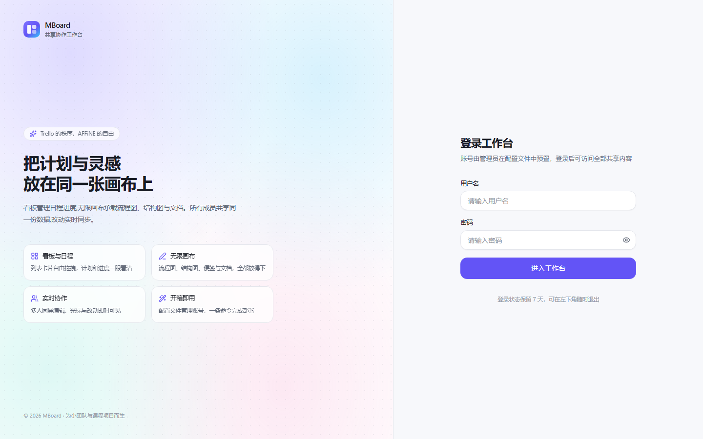

## 功能特性

### 账号与访问
- 账号预置在 `config/accounts.yml`，支持明文密码或 bcrypt 哈希
- 默认 4 个账号：maxy / tannami / fashi / tomato，密码均为 `123456`
- JWT + HttpOnly Cookie 会话，中间件统一拦截未登录请求
- 登录用户权限平等，所有看板、画板、文档、附件全局共享
- **账号设置**：左下角头像菜单进入，可修改自己的显示名和登录密码
- 深浅色主题、响应式布局

### 看板（Trello 式）
- 看板 → 列表 → 卡片三级结构，列表横排拖拽排序
- 卡片跨列表拖动，乐观更新 + 失败回滚
- 卡片详情抽屉：标题、标签、**多人负责人**、截止时间、Markdown 描述（编辑 / 预览）、附件上传下载、归档、删除
- 看板重命名、描述、主题色、删除，空状态引导

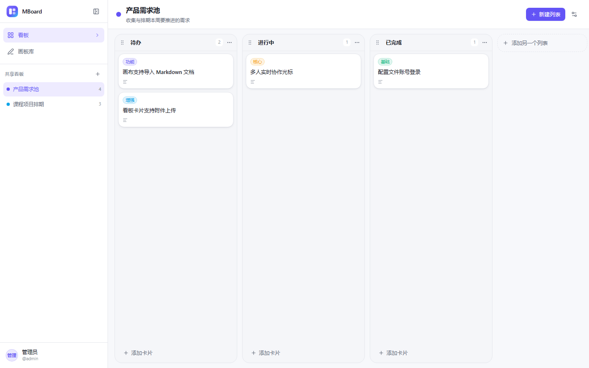

### 负责人与我的任务（Notion 式）
- 每张卡片可以分配一个或多个负责人，成员列表来自账号配置
- 侧边栏「我的任务」汇总所有看板中分配给你的卡片，按看板分组，显示列表、标签、截止时间与负责人
- 任务行显示逾期状态，点击直接跳转到对应看板并自动打开卡片详情
- 负责人变化后，对应的「我的任务」即时反映（刷新页面）

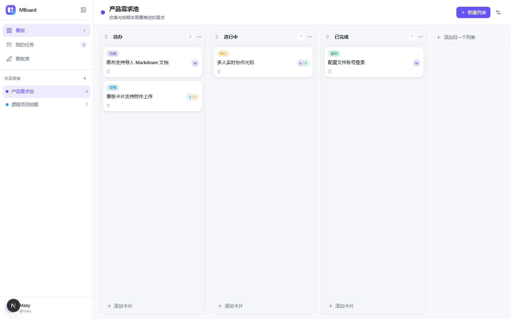

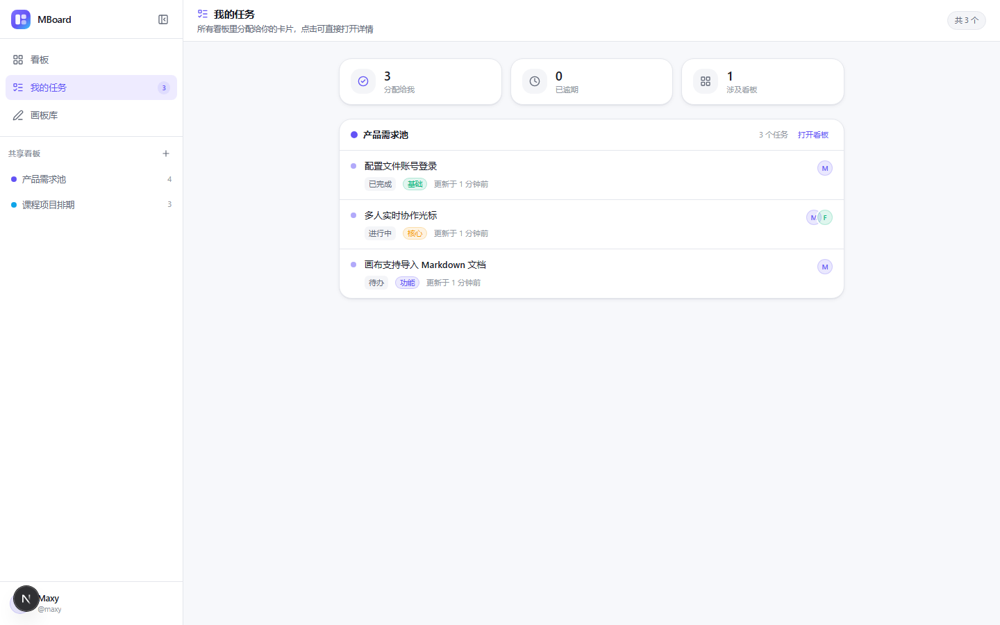

### 无限画布（AFFiNE 式）
- 基于 Excalidraw 内核：无限坐标系、平移缩放、框选、撤销重做、旋转缩放、图层顺序、自由连线与锚点吸附
- 打开画板有路由级加载态；进入画板库后会空闲预热画布引擎，缩短首次打开等待
- 侧栏一键插入：便签、文本、矩形 / 圆形 / 菱形、箭头、图片、视频、Markdown 文档卡片、表格、组合卡片
- **组合卡片（故事卡）**：标题 + 字段 + 关联文档装进一张竖卡，整张拖动、字段可编辑、文档条目单击打开
- **画框/容器拖动**：原生画框、组合卡片、分组容器都可以点内部任意空白处直接拖动，不用再找边框
- **画框自由收纳**：画框内组件数量不限，图片/文本拖进去自动成为成员，拖出自动移出；成员可在画框内自由拖动调整位置
- **文档单击直接打开编辑**：Obsidian 式实时 Markdown 预览，默认显示渲染结果，光标所在行才显示原始语法
- **文件卡片按类型区分**：Markdown / TXT / PDF / Word / Excel / PPT 使用不同图标和底色，单击即可打开
- **表格可视化编辑**：直接点单元格改内容、增删行列，保存自动转成 Markdown 表格
- **拖拽导入**：.md / .txt / .pdf / Office / 图片 / 视频直接拖进画布即可生成文档或文件卡片
- **导入导出**：文档可下载为 Markdown，文件卡片可下载原文件
- **分组**：框选多个元素后点「分组」，生成带标题的容器，拖动任意成员即可整体移动
- 选中画布上的文档卡片时，右侧面板会自动渲染文档内容，不用再点预览
- 图片自动转存资源库并注入画布，避免场景 JSON 膨胀
- 画板库支持缩略图、搜索、重命名、删除、复制链接

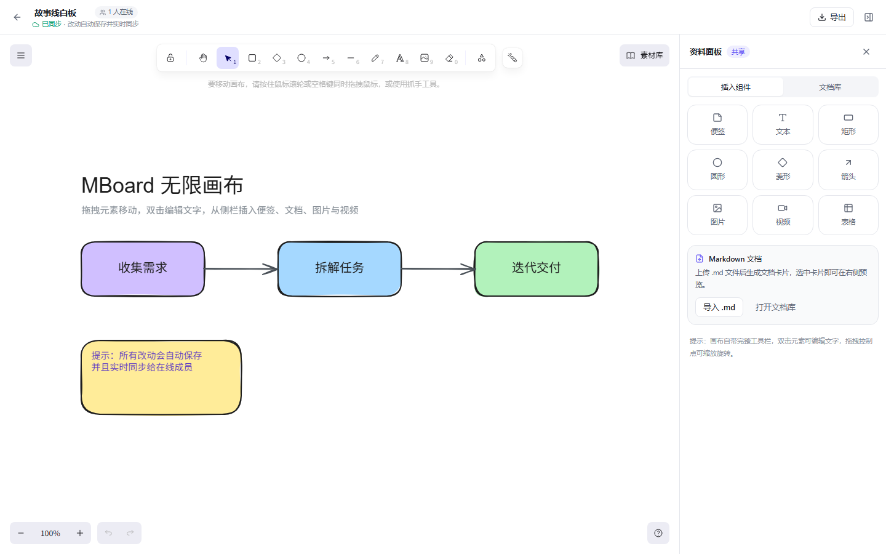

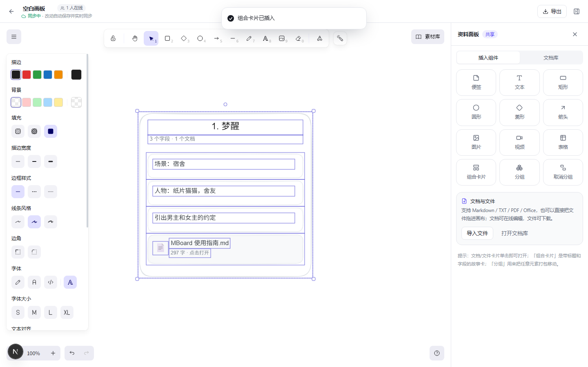

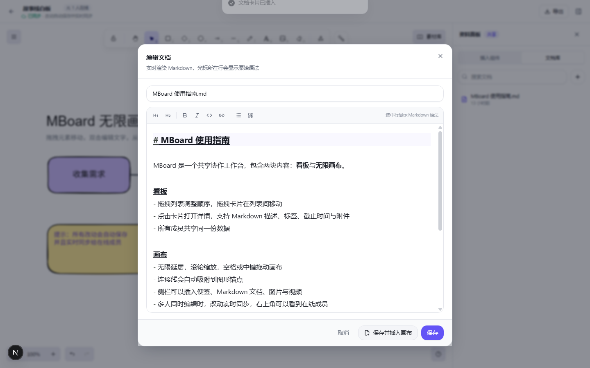

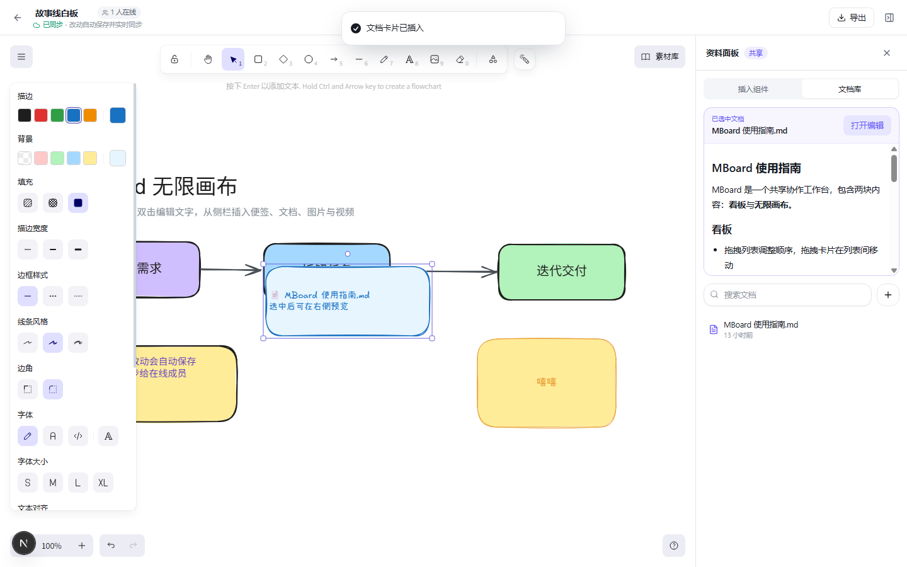

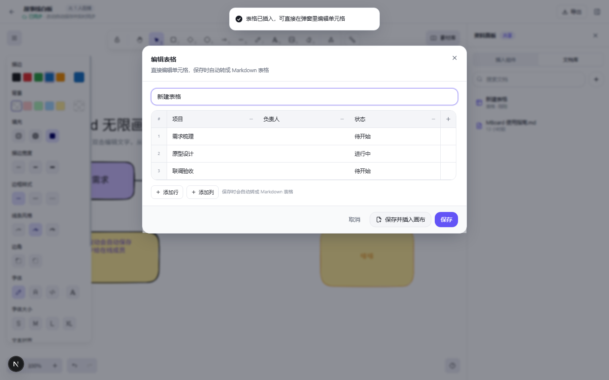

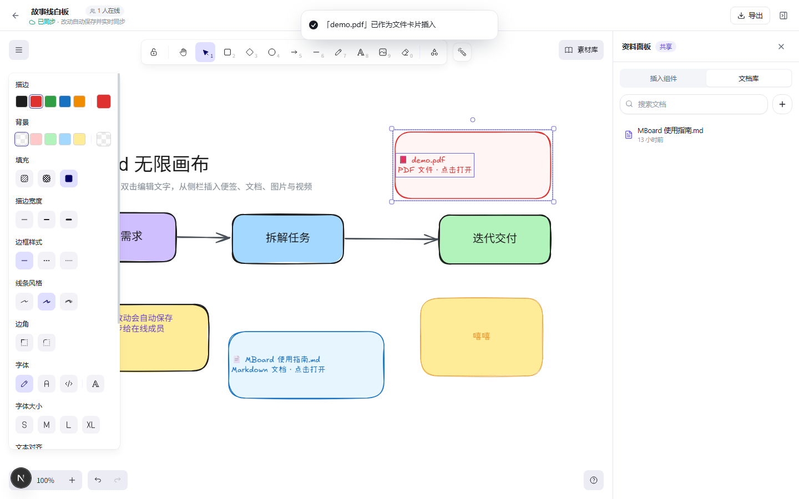

### 实时协作
- 画布基于 **Yjs CRDT + WebSocket**，多人同时编辑自动合并，不会互相覆盖
- 在线成员头像、**带名字的实时光标**、选区高亮、断线重连
- 服务端增量持久化到 SQLite，空闲房间自动卸载
- 画布缩略图由客户端定时导出并上传，画板库实时可见

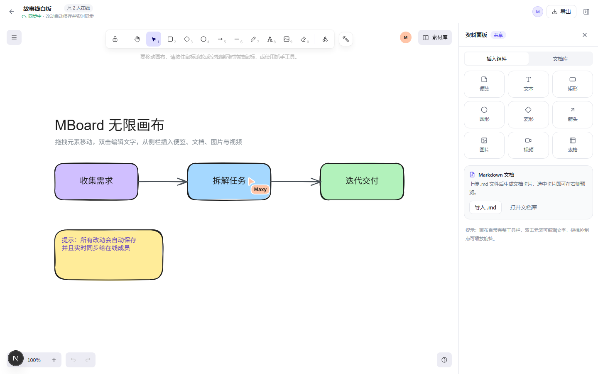

| 看板（深色） | 画布（深色） |
| --- | --- |
| 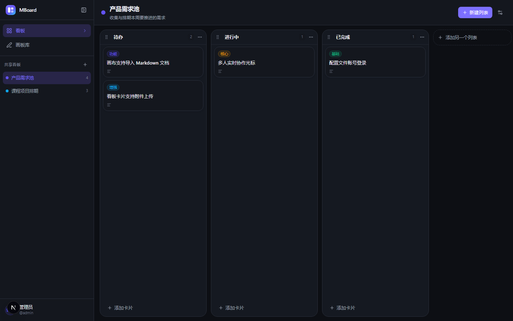 | 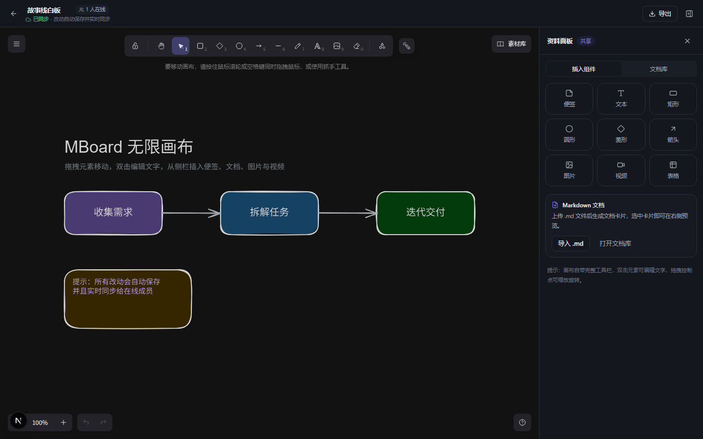 |

## 技术栈

| 层 | 选型 |
| --- | --- |
| 框架 | Next.js 15.5（App Router）+ React 19 + TypeScript |
| 样式 | Tailwind CSS 3.4 + 自建设计 token / 组件 |
| 数据库 | SQLite + Prisma 6 |
| 画布 | Excalidraw 0.18（MIT）+ 自研 Yjs 协作绑定 |
| 协作 | Yjs + y-protocols + ws（与 Next 共用端口） |
| 拖拽 | dnd-kit |
| Markdown | react-markdown + remark-gfm |
| 鉴权 | jose（JWT）+ bcryptjs |
| 部署 | Docker Compose（单容器 + 数据卷） |

## 快速开始（本地）

环境：Node.js ≥ 20、npm。

```bash
cd D:\JS_Workspace\MBoard

npm install
copy .env.example .env     # macOS / Linux: cp .env.example .env

npm run setup              # 生成 Prisma Client、建表、写入演示数据
npm run dev                # http://localhost:3000
```

默认账号（见 `config/accounts.yml`，上线前务必修改）：

| 用户名 | 密码 | 显示名 |
| --- | --- | --- |
| maxy | 123456 | Maxy |
| tannami | 123456 | Tannami |
| fashi | 123456 | Fashi |
| tomato | 123456 | Tomato |

> PowerShell 默认禁止运行 `npm.ps1` 时，用 `cmd /c "npm.cmd run dev"`。

> 开发模式首次访问某个路由会按需编译（可能几秒），启动 dev 后可另开终端执行 `npm run warm` 预先编译主要页面；生产构建没有这个等待。

## Docker 部署

```bash
copy .env.example .env
# 修改 .env 里的 AUTH_SECRET 和 config/accounts.yml 里的账号

docker compose up -d --build
# 打开 http://服务器IP:3000
```

- 数据库与上传文件：`./data`（挂载进容器 `/app/data`，备份这个目录即可）
- 账号配置：`./config/accounts.yml`（只读挂载，改完 `docker compose restart`）
- 容器启动时自动执行 `prisma db push` 和幂等种子脚本
- 反向代理、HTTPS、备份升级见 [部署文档](docs/DEPLOY.md)

## 账号配置

账号白名单写在 `config/accounts.yml`，登录后可以在「账号设置」里改显示名和密码。

```yaml
# config/accounts.yml
users:
  - username: maxy
    passwordHash: "$2b$10$..."   # 推荐：bcrypt 哈希
    displayName: "Maxy"
    color: "#6353f5"             # 头像底色（光标颜色由画布按用户分配）
```

生成哈希：

```bash
npm run hash -- "你的新密码"
```

修改配置后重启服务生效；新增 / 删除账号只改文件，不需要数据库。

## 账号设置

登录后点击左下角头像 → **账号设置**：

- **修改显示名**：会显示在画布协作光标、在线成员列表和头像上；保存后刷新画布即可看到新名字
- **修改密码**：需要输入当前密码，新密码至少 6 位；修改结果写入数据库，覆盖配置文件里的初始密码，当前登录状态不受影响
- 配置文件仍是账号白名单：删除账号后，即使数据库里还有个人设置也无法登录

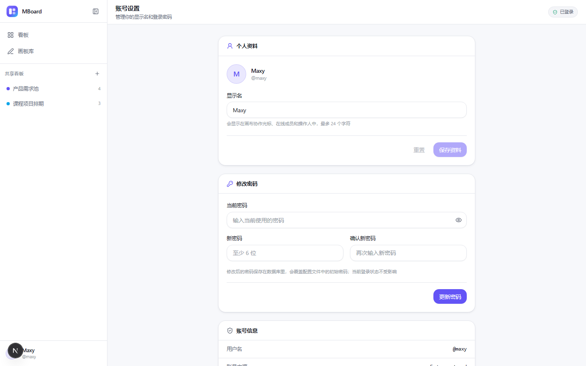


## 常用脚本

| 命令 | 说明 |
| --- | --- |
| `npm run dev` | 开发模式（Next + 协作 WebSocket，同端口） |
| `npm run warm` | 开发态预热：启动 dev 后另开终端执行，提前编译主要路由 |
| `npm run build` / `npm start` | 生产构建 / 启动（生产无按需编译） |
| `npm run setup` | 生成 Client、建表、种子数据 |
| `npm run typecheck` | TypeScript 全量检查 |
| `npm run db:seed` | 手动补种子数据（幂等） |
| `npm run hash -- "密码"` | 生成 bcrypt 哈希 |

## 目录结构

```text
MBoard/
├── app/                    # App Router：页面与 API
│   ├── (workspace)/        # 带侧边栏的工作台布局
│   │   ├── boards/         # 看板
│   │   └── canvases/       # 画板库
│   ├── canvas/[id]/        # 全屏画布编辑器
│   ├── login/              # 登录页
│   └── api/                # 看板 / 画板 / 资源 / 文档 / 鉴权
├── components/
│   ├── ui/                 # 基础组件
│   ├── workspace/          # 侧边栏、工作台外壳
│   ├── kanban/             # 看板组件
│   └── canvas/             # 画布编辑器与资源面板
├── lib/
│   ├── auth/               # 会话、账号配置
│   ├── collab/             # Yjs 服务端 + 浏览器 Provider
│   └── prisma.ts
├── prisma/                 # schema 与种子数据
├── config/accounts.yml     # 账号白名单
├── docker/                 # 容器入口脚本
├── docs/                   # 契约、架构、部署、截图
└── server.mjs              # Next + WebSocket 统一入口
```

## 文档

- [架构与协作机制](docs/ARCHITECTURE.md)
- [Docker / 云服务器部署](docs/DEPLOY.md)
- [开发契约与接口清单](docs/CONTRACT.md)

## 已知限制

- 看板多人协作以服务端数据为准，其他成员的改动需要刷新或切换页面后可见；画布是实时同步
- 通用上传资源暂未提供独立删除接口（卡片删除后文件保留），画板缩略图会随画板删除清理
- SQLite 单实例写入，适合小团队；水平扩展需换 Postgres 并把 Yjs 持久化迁到共享存储
- 暂未提供历史版本、回收站、权限分级

## 验证脚本（可选）

需要本机 Chrome 与已启动的服务：

```bash
node scripts/collab-test.mjs <canvasId>          # 协议层双端同步测试
node scripts/collab-e2e.mjs <canvasId>           # 双标签页真实协作（仅开发模式）
node scripts/cursor-e2e.mjs <canvasId>           # 双账号光标与用户名验证（仅开发模式）
node scripts/browser-check.mjs /boards board.png # 无头浏览器截图 + 控制台检查
```
