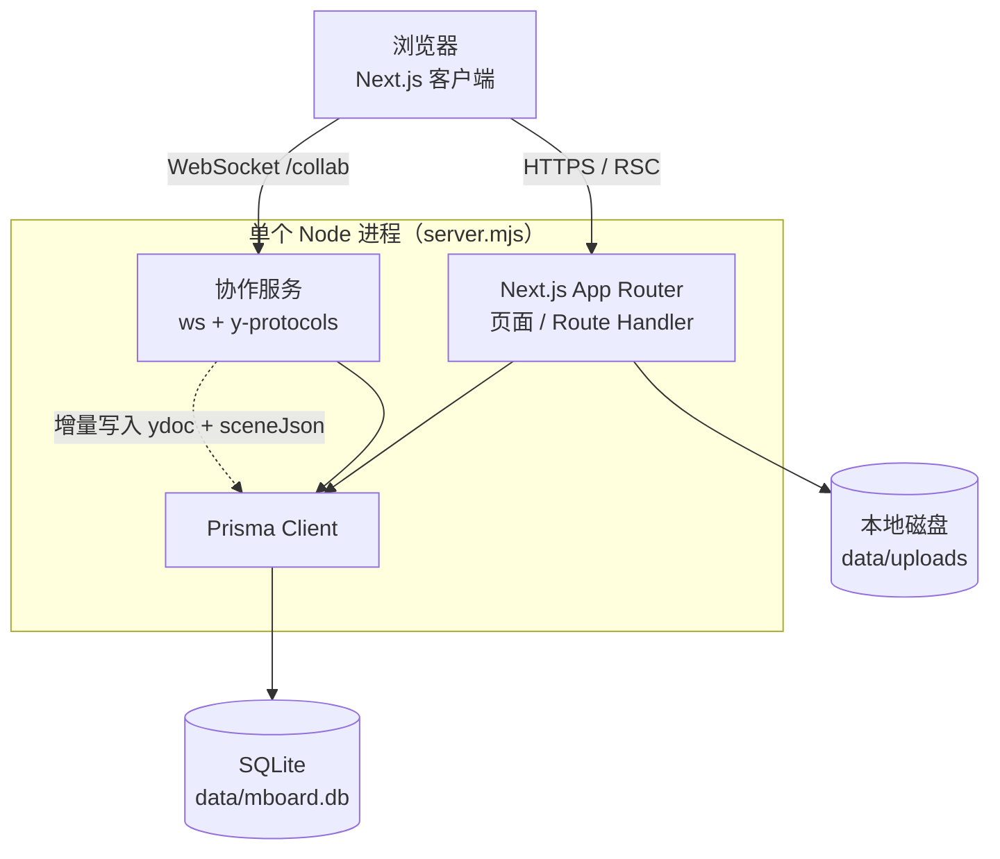
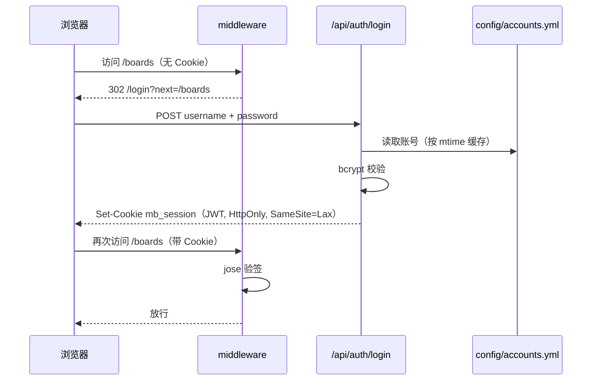
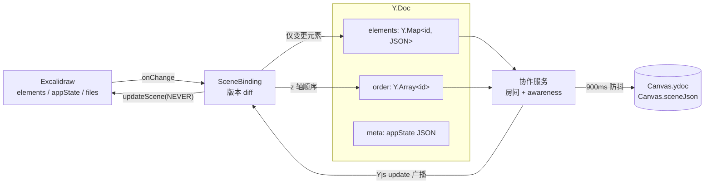
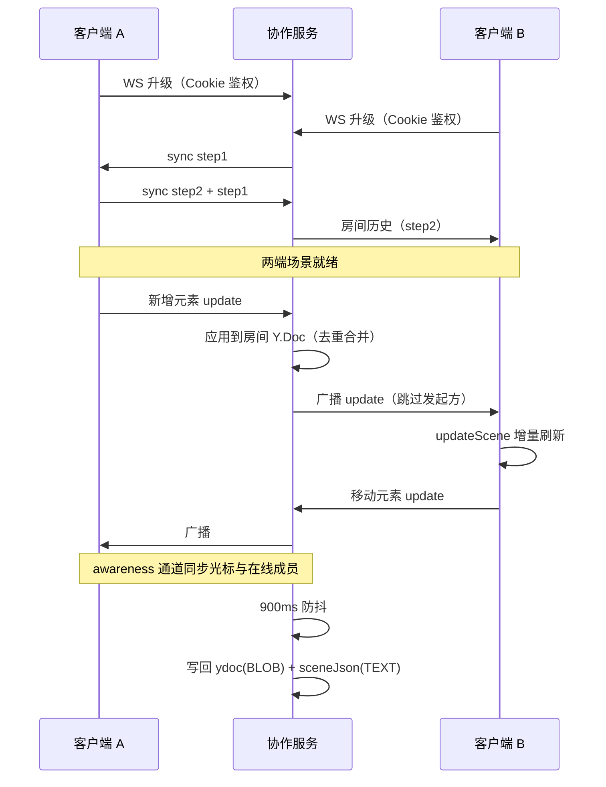
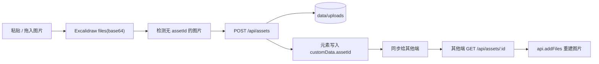
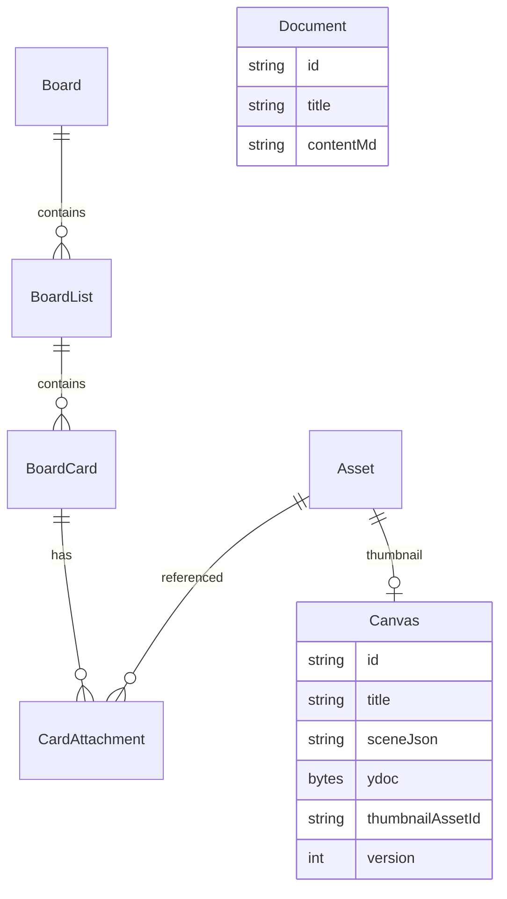

# MBoard 架构与协作机制

> 目标：在单台云服务器上提供「看板 + 无限画布 + 多人实时协作」，部署简单、数据可备份。

## 1. 系统结构

- 页面与 API 由 Next.js 提供，协作 WebSocket 与 HTTP 共用 3000 端口（`server.on('upgrade')` 接管 `/collab`）
- 数据层只有 SQLite 一个文件；资源文件落在 `data/uploads`，数据库里只存元数据
- 容器部署时挂载 `./data` 即可同时备份数据库与附件

## 2. 登录链路

账号不进入数据库（白名单仍由配置文件决定）；用户可以在「账号设置」里修改显示名和密码，个人覆盖写入 `UserProfile` 表。中间件在 Edge Runtime 中完成验签，API 路由再从 Cookie 读取会话用于记录操作人。修改显示名后会重新签发 JWT，保证下一次请求拿到的就是新名字。

## 3. 画布数据模型

Excalidraw 负责渲染与交互，Yjs 负责多端一致性，SQLite 负责持久化。

- `elements` 以元素 id 为键，单个元素的并发修改走 LWW，不同元素并行编辑互不影响
- `order` 单独维护 z 轴顺序，避免因 map 无序导致图层错乱
- 远端更新通过 `updateScene(..., captureUpdate: "NEVER")` 应用，不污染本地撤销栈
- 本地变更与服务端广播通过版本号 diff 去重，避免回声

## 4. 协作时序（两人同时编辑）

实现要点：
- **房间并发去重**：`pendingRooms` 用 Promise 占位，避免两个连接同时初始化时创建两个房间（曾导致「能同步但互不广播」）
- **权限**：升级握手时解析 Cookie 并验签，失败返回 401
- **持久化**：房间内文档更新防抖落库；`sceneJson` 作为缩略图/导出兜底；空闲 10 分钟且无连接时卸载房间
- **心跳**：30 秒 ping/pong 清理僵死连接

## 5. 资源与缩略图

- 场景 JSON 中不保留 base64，只保留 `fileId + assetId`，避免画布数据膨胀
- 打开画布时按需拉取图片资源，生成 dataURL 后注入 Excalidraw
- 缩略图由客户端每 30 秒（以及进入 5 秒后）导出，统一合成 1200×750、16:10 居中留白后上传

## 6. 数据模型

看板、画板、文档、资源都没有 `userId`：登录身份只用于鉴权与展示，数据全局共享。

## 7. 关键设计决策

| 决策 | 原因 |
| --- | --- |
| Excalidraw 而非自研画布 | 无限画布、连线吸附、旋转缩放、撤销重做的工程量极大，MIT 协议可直接商用 |
| Yjs 元素级 CRDT | 多人同时拖动不同元素不会互相覆盖；比整场景快照覆盖体验好得多 |
| SQLite 而非 Postgres | 单机小团队写入量低，部署与备份成本最低；schema 未使用 Json 等不可移植类型，后续可迁移 |
| 本地磁盘而非对象存储 | 少一个容器与凭证；资源通过鉴权 API 读取，后续可加 S3 驱动 |
| 单进程 + 同端口 | 反向代理简单，不需要额外暴露 WebSocket 端口 |

## 8. 后续可扩展方向

- 看板实时化：把看板变更也接入 Yjs 或增加 SSE 广播
- 协作增强：跟随视图、评论、@提醒、历史版本
- 存储升级：Postgres + MinIO/S3，Yjs 持久化迁移到共享存储
- 权限分级：只读访客、看板级权限、操作审计
- 移动端手势优化与画布离线缓存
